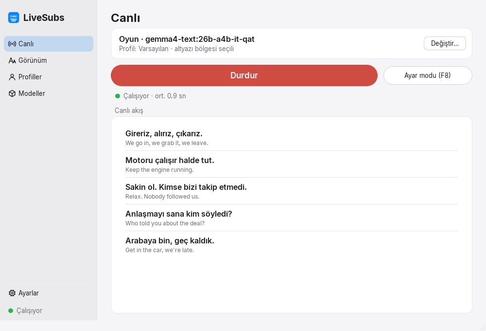
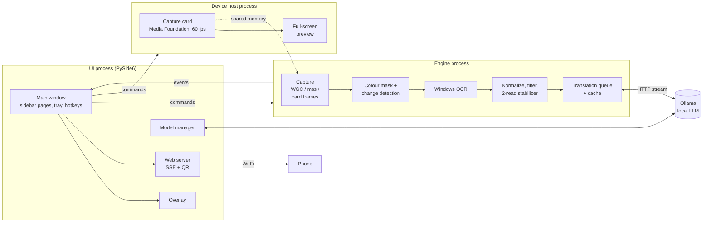

# LiveSubs

> Real-time, fully local English → Turkish subtitle translation for any game on Windows.

[](https://github.com/MertCodur-0/LiveSubs/actions/workflows/ci.yml)
[](LICENSE)


[Türkçe](README.tr.md)

LiveSubs reads the subtitle area of a game window, a monitor or a console's picture coming in
through an HDMI capture card with Windows' built-in OCR, translates each line with a local LLM
through [Ollama](https://ollama.com), and shows the translation in a click-through overlay on top of
the game, or on your phone. It uses no cloud APIs: capture, OCR and translation all run on your own
PC.

| Apple dark (default) | Apple light |
| --- | --- |
|  |  |

<!-- Demo GIF goes here: docs/images/demo.gif (record it with recording mode on). -->

## Features

- **Any game, any source.** Draw a box around the subtitles on any screen. LiveSubs picks the
  window under it (or the whole monitor) and keeps following it when the window moves.
- **Consoles through a capture card.** A PS5 (or any HDMI source) through a USB capture card:
  LiveSubs owns the card and can show its picture full screen on a PC monitor, edge to edge and
  independent of translation, for example for a TV light strip app that samples that screen.
- **Reads subtitles over busy backgrounds.** A colour + local-contrast mask keeps only
  subtitle-coloured strokes, so bright skies, roads and HUDs are ignored. Words hidden on one
  frame are picked up from later ones, and the line is upgraded in place.
- **Natural Turkish.** The prompt asks for colloquial Turkish (slang and swearing included), keeps
  names untouched, and uses the previous lines plus a per-game context and glossary.
- **Every line, in order.** Short replies between long lines are never skipped, and a translation
  stays readable after its subtitle disappears.
- **Overlay hidden from capture.** The overlay is click-through and invisible to screen capture,
  so OCR never reads its own output. A recording mode turns this off for OBS.
- **Phone output.** Scan a QR code and read the translations on your phone over Wi-Fi: a black
  page where the newest line appears at the top. You can also turn the PC overlay off entirely.
- **Model management.** List, download and delete Ollama models in the app. It estimates whether
  each model fits your GPU (VRAM per profile) and compares two models side by side on your own
  lines.
- **Per-game profiles.** Source, region, colours, overlay style and position, context and
  glossary, game VRAM reserve.
- **Real app.** Double-click the exe and a setup dialog installs what is missing. It has global
  hotkeys, a tray icon and a calibration mode with a live Inspector. A macOS-Settings-like
  window with a sidebar; themes Apple dark (default), Apple light, Apple following
  Windows' light/dark setting, Vice (neon sunset) and plain dark.

| Settings with the phone QR code | Phone page |
| --- | --- |
|  |  |

## How it works



- **Separate processes.** Capture, OCR and translation run in an engine process, so a busy UI
  can never stall them. A capture card is owned by a third process, the device host: Windows lets
  only one app read a card, and its preview must keep running while translation is stopped or
  the engine restarts. Processes exchange typed messages over `multiprocessing` queues; card
  frames (1080p60) go through shared memory, and the engine takes the newest one at its own pace.
- **Capture:** Windows Graphics Capture (zero-copy frames, cropped to the client area), with a GDI
  fallback. Capture cards are read through OpenCV's Media Foundation backend as uncompressed
  YUY2 (measured: steady 60 fps at 1080p, opens in ~0.3 s).
- **Vision:** only the text mask is compared between frames, so a moving background never
  triggers a re-read. A new line needs two agreeing reads.
- **Translation:** Ollama `/api/chat` streaming with a few-shot prompt, temperature 0, an LRU +
  SQLite cache, and history as real chat turns. Requests can be cancelled mid-stream.

Measured on an RTX 4070 Laptop (8 GB): OCR takes 10–25 ms per line. Translation takes about
1.1–1.6 s with `gemma4:26b-a4b-it-qat` or `gemma4:12b-it-qat`. The setup dialog makes a
text-only copy of the 26b model: the same weights without the unused vision encoder, which
leaves ~1 GB of VRAM to the model's experts and makes it ~12 % faster.

## Requirements

- Windows 10 2004+ or Windows 11 (64-bit)
- An NVIDIA GPU with 8 GB VRAM or more is recommended (smaller models run on less)
- 16 GB RAM. The recommended `gemma4:26b-a4b` model keeps its experts in RAM and needs 24 GB+.
- The game should run **windowed or borderless**: nothing can draw over exclusive fullscreen
  (LiveSubs warns you).

Ollama, the English OCR language pack and a translation model are installed by the app itself.

## Install

1. Download `LiveSubs-x.y.z-win64.zip` from [Releases](https://github.com/MertCodur-0/LiveSubs/releases)
   and unzip it anywhere.
2. Double-click **LiveSubs.exe**. If something is missing, the **Setup** dialog offers it with
   one click each:
   - the English (en-US) Windows OCR language (asks for admin rights),
   - Ollama (via `winget`),
   - a translation model, picked by your RAM,
   - desktop and Start menu shortcuts,
   - importing settings you exported earlier (handy after reinstalling Windows).

### Why is LiveSubs.exe a renamed `pythonw.exe`?

Windows 11's **Smart App Control** blocks unsigned executables that have no reputation, and a
PyInstaller-style bootloader is a new unsigned binary on every build. LiveSubs therefore ships the
official **embeddable Python**. Its `pythonw.exe` is signed by the Python Software Foundation; it
is renamed to `LiveSubs.exe` and starts the app from the bundled packages. Windows sees a
trusted, signed interpreter, and no code-signing certificate is needed. The build script verifies
the signature on every build.

## Usage

1. **Select the subtitle region** and draw a box around where subtitles appear. The window under
   it becomes the source.
2. Pick a model and press **Start**. The first start loads the model into memory and can take
   10–40 s. Lines are read during that time and translated as soon as the model is ready.
3. Fine-tune if needed:

| Key | Action |
| --- | --- |
| **F8** | Calibration mode: move/resize the region and the overlay, open the Inspector (what OCR sees, the colour mask, the filter's verdict, live colour/threshold tweaks) |
| **F9** | Hide/show the translation |
| **F10** | Pause/resume |

Hotkeys can be changed in Settings. They use `RegisterHotKey`, not keyboard hooks, so no admin
rights are needed and anti-cheat systems are not bothered.

- **Appearance:** overlay presets (Classic, Vice, Box), font, size, colours, outline, shadow,
  background, maximum lines, the English original underneath, and placement (above, over or
  below the subtitle, or anywhere you drag it).
- **Phone:** Settings → *Telefonda göster*. Scan the QR code; the phone must be on the same
  Wi-Fi network, and Windows asks once for firewall access (allow *Private networks*).
  *Show the translation only on the phone* turns the PC overlay off.
- **Capture card (console):** pick *Yakalama kartı: <name>* as the source, or turn on Settings →
  *Yakalama kartı önizlemesi* and draw the region on the full-screen preview. Without a preview,
  *Select the subtitle region* shows a still frame of the card to draw on. The card can be used by
  one app at a time, so close OBS (LiveSubs opens the card as soon as it is free). A black picture
  usually means HDCP: on a PS5, turn off Settings → System → HDMI → *Enable HDCP*. Press Esc on the
  preview to close it.
- **Profiles:** one per game: context ("gritty crime story set in the 80s"), a glossary of
  names and terms, where the game runs (sets the VRAM reserve), and which screen the overlay
  goes to.

The UI is in Turkish (strings live in `livesubs/i18n`, ready for translation).

## Roadmap

- A Claude API translation backend as an alternative to Ollama
- More target languages

## Development

Requires **Python 3.13** (some native dependencies do not build on newer versions yet).

```powershell
py -3.13 -m venv .venv
.\.venv\Scripts\python.exe -m pip install -e ".[dev]"
.\.venv\Scripts\python.exe -m livesubs          # run the app
.\.venv\Scripts\python.exe -m pytest            # all tests
ruff check . ; ruff format .                    # lint / format
.\scripts\build_exe.ps1                         # dist\LiveSubs-<version>-win64.zip
```

Tests that need Windows OCR, a running Ollama or real desktop capture are marked `ocr`,
`ollama` and `capture`. CI runs `pytest -m "not ocr and not ollama and not capture"`. Sample
screenshots used by the OCR tests are game footage, so they are not in the repository;
`tests/samples/samples.json` describes them, and those tests skip when an image is missing.

```
src/livesubs/
  core/        config, profiles, IPC messages, geometry
  device/      device host process: capture card, shared frames, full-screen preview
  engine/      engine process: capture/, vision/, ocr/, text/, translate/
  ollama/      REST client, model catalog, VRAM estimate, model comparison
  platform/    Win32 helpers, hotkeys, GPU (DXGI), shortcuts
  ui/          main window, pages, overlay, calibration, setup dialog, theme
  web/         phone output: SSE server, page
```

## Credits

- Fonts: [Inter](https://rsms.me/inter/), [Audiowide](https://fonts.google.com/specimen/Audiowide)
  and [Monoton](https://fonts.google.com/specimen/Monoton) (the last two in the Vice theme), all
  under the SIL Open Font License (texts in `src/livesubs/assets/fonts`).
- Icons and header art are original. LiveSubs is not affiliated with any game or publisher.

## License

[MIT](LICENSE)
