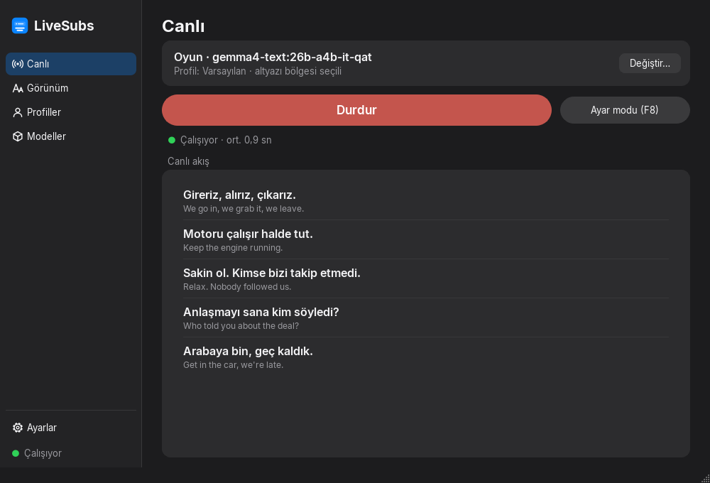
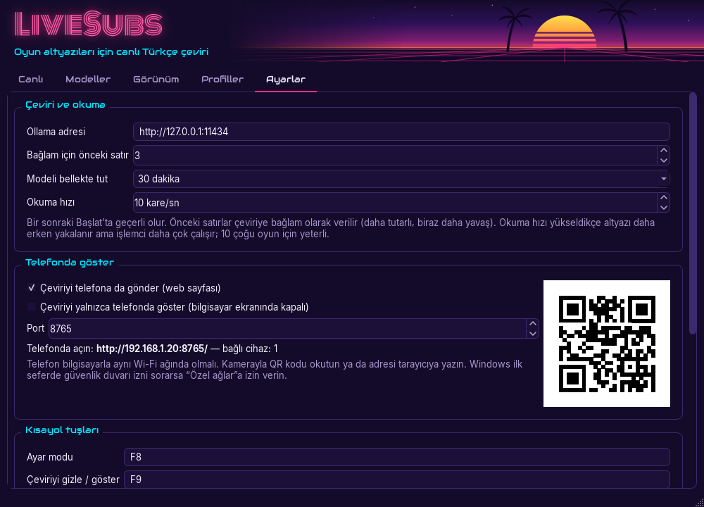
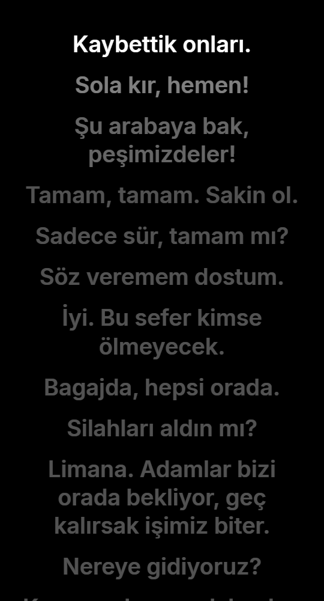
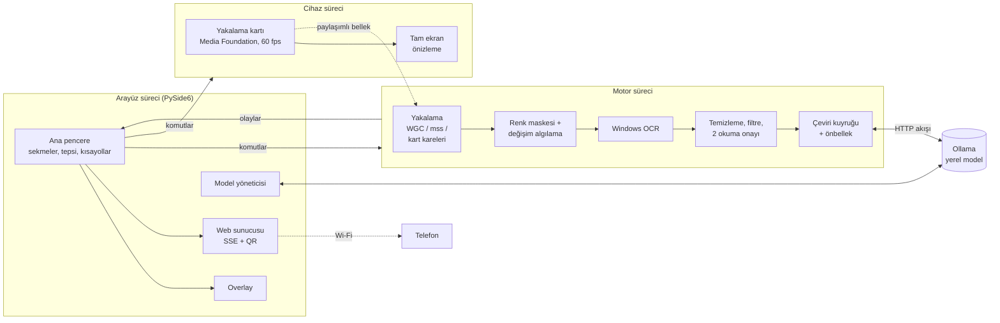

# LiveSubs

> Windows'ta herhangi bir oyunun İngilizce altyazısını gerçek zamanlı ve tamamen yerel olarak Türkçeye çevirir.

[](https://github.com/MertCodur-0/LiveSubs/actions/workflows/ci.yml)
[](LICENSE)


[English](README.md)

LiveSubs, bir oyun penceresinin, monitörün ya da HDMI yakalama kartından gelen konsol görüntüsünün
altyazı bölgesini Windows'un yerleşik OCR'ı ile okur. Her satırı [Ollama](https://ollama.com)
üzerinden yerel bir dil modeliyle çevirir ve çeviriyi oyunun üstünde, tıklamaları engellemeyen bir
katmanda (overlay) ya da telefonunda gösterir. Bulut servisi kullanmaz: yakalama, OCR ve çeviri
tamamen kendi bilgisayarında çalışır.



<!-- Demo GIF buraya: docs/images/demo.gif (kayıt modu açıkken kaydedin). -->

## Özellikler

- **Her oyun, her kaynak.** Altyazının çıktığı yeri hangi ekranda olursa olsun fareyle çizersin.
  Altındaki pencere (ya da monitörün tamamı) kaynak olur; pencere taşınırsa onu takip eder.
- **Yakalama kartıyla konsollar.** PS5 (ya da herhangi bir HDMI kaynağı) USB yakalama kartı
  üzerinden: kartı LiveSubs açar ve görüntüsünü bir PC monitöründe, çeviriden bağımsız olarak
  kenardan kenara tam ekran gösterebilir; örneğin o ekranı okuyan bir TV arkası ışık
  (Ambilight) uygulaması için.
- **Hareketli arka planda bile okur.** Renk ve yerel kontrast maskesi yalnızca altyazı
  rengindeki ince çizgileri bırakır; parlak gökyüzü, yol ve arayüz öğeleri yok sayılır. Bir
  karede seçilemeyen kelimeler sonraki karelerden tamamlanır ve satır yerinde güncellenir.
- **Doğal Türkçe.** Argo ve küfür dahil günlük konuşma dilinde çevirir, isimleri olduğu gibi
  bırakır. Önceki satırları, oyuna özel bağlam metnini ve sözlüğü de dikkate alır.
- **Her satır, sırasıyla.** Uzun satırların arasındaki kısa cevaplar atlanmaz. Altyazı ekrandan
  kalktıktan sonra da çeviri okunacak kadar ekranda kalır.
- **Yakalamaya görünmeyen overlay.** Overlay tıklamaları geçirir ve ekran yakalamaya görünmez;
  böylece OCR kendi çevirisini okumaz. Kayıt modu, OBS'nin de görmesi için bunu kapatır.
- **Telefonda gösterme.** QR kodu okutup çevirileri aynı Wi-Fi'daki telefonundan okursun: siyah
  bir sayfa, en yeni satır en üstte. İstersen bilgisayardaki çeviriyi tamamen kapatabilirsin.
- **Model yönetimi.** Ollama modellerini uygulama içinden listeler, indirir ve silersin. Her
  modelin ekran kartına sığıp sığmadığını (profile göre VRAM) tahmin eder ve iki modeli kendi
  satırlarınla yan yana karşılaştırır.
- **Oyun başına profil.** Kaynak, bölge, renkler, overlay stili ve konumu, bağlam ve sözlük,
  oyuna ayrılan VRAM.
- **Gerçek uygulama.** Exe'ye çift tıklarsın; eksik bir şey varsa kurulum penceresi kurar.
  Genel kısayol tuşları, sistem tepsisi simgesi ve canlı Inspector'lı ayar modu var.

| Ayarlar ve telefon QR kodu | Telefon sayfası |
| --- | --- |
|  |  |

## Nasıl çalışır



- **Ayrı süreçler.** Yakalama, OCR ve çeviri ayrı bir motor sürecinde çalışır; arayüz meşgul
  olsa da onları durduramaz. Yakalama kartını üçüncü bir süreç, cihaz süreci açar: Windows bir
  kartı aynı anda tek uygulamaya verir ve önizleme, çeviri durduğunda ya da motor yeniden
  başladığında da kesilmemelidir. Süreçler `multiprocessing` kuyrukları üzerinden tipli
  mesajlarla haberleşir; kartın kareleri (1080p60) paylaşımlı bellekten geçer ve motor en
  yenisini kendi hızında alır.
- **Yakalama:** Windows Graphics Capture (kopyasız kareler, pencerenin iç alanına kırpılır),
  gerekirse GDI ile yedek yakalama. Yakalama kartları OpenCV'nin Media Foundation arka ucuyla
  sıkıştırmasız YUY2 olarak okunur (ölçülen: 1080p'de kesintisiz 60 fps, ~0,3 sn'de açılır).
- **Görüntü:** kareler arasında yalnızca yazı maskesi karşılaştırılır; hareket eden arka plan
  yeniden okumayı tetiklemez. Yeni bir satırın kabul edilmesi için iki okumanın aynı sonucu
  vermesi gerekir.
- **Çeviri:** Ollama `/api/chat` akışı. Örnekli istem, sıcaklık 0, LRU + SQLite önbellek;
  önceki satırlar gerçek sohbet turları olarak verilir. Bir istek akış sırasında iptal
  edilebilir.

RTX 4070 Laptop'ta (8 GB) ölçülen süreler: OCR satır başına 10–25 ms. Çeviri
`gemma4:26b-a4b-it-qat` ya da `gemma4:12b-it-qat` ile yaklaşık 1,1–1,6 sn. Kurulum penceresi
26b modelinin yalnızca metin kopyasını oluşturur: aynı ağırlıklar, ama kullanılmayan görüntü
kodlayıcı olmadan. Açılan ~1 GB VRAM uzman katmanlarına kalır ve model ~%12 hızlanır.

## Gereksinimler

- Windows 10 2004+ ya da Windows 11 (64 bit)
- 8 GB veya daha fazla VRAM'li bir NVIDIA ekran kartı önerilir (küçük modeller daha azıyla
  çalışır)
- 16 GB RAM. Önerilen `gemma4:26b-a4b` modeli uzman katmanlarını RAM'de tutar ve 24 GB ve üstü
  ister.
- Oyun **pencereli ya da kenarlıksız pencere** modunda çalışmalı: özel tam ekranın üstüne hiçbir
  şey çizilemez (LiveSubs bu durumda uyarır).

Ollama'yı, İngilizce OCR dil paketini ve çeviri modelini uygulama kendisi kurar.

## Kurulum

1. [Releases](https://github.com/MertCodur-0/LiveSubs/releases) sayfasından
   `LiveSubs-x.y.z-win64.zip` dosyasını indir ve istediğin bir klasöre çıkar.
2. **LiveSubs.exe**'ye çift tıkla. Eksik bir şey varsa **Kurulum** penceresi her birini tek
   tıkla kurmayı önerir:
   - Windows'un İngilizce (en-US) OCR dili (yönetici izni ister),
   - Ollama (`winget` ile),
   - RAM'ine göre seçilen bir çeviri modeli,
   - masaüstü ve Başlat menüsü kısayolları,
   - daha önce dışa aktardığın ayarları içe aktarma (Windows'u yeniden kurduktan sonra işe
     yarar).

### LiveSubs.exe neden adı değiştirilmiş bir `pythonw.exe`?

Windows 11'in **Akıllı Uygulama Denetimi** (Smart App Control), imzasız ve bilinmeyen exe'leri
engeller. PyInstaller tarzı bir başlatıcı ise her derlemede yeni ve imzasız bir dosyadır. Bu
yüzden LiveSubs resmi **gömülebilir Python** ile gelir. Bunun `pythonw.exe` dosyası Python
Software Foundation tarafından imzalıdır; adı `LiveSubs.exe` olarak değiştirilir ve uygulamayı
paketteki dosyalardan başlatır. Windows güvenilir, imzalı bir yorumlayıcı görür; ayrıca kod
imzalama sertifikası gerekmez. Derleme betiği bu imzayı her derlemede doğrular.

## Kullanım

1. **Altyazı bölgesini seç** ve altyazının çıktığı yeri fareyle çiz. Altındaki pencere kaynak
   olur.
2. Bir model seç ve **Başlat**'a bas. İlk başlatmada model belleğe yüklenir; bu 10–40 sn
   sürebilir. Bu sırada satırlar okunmaya devam eder ve model hazır olunca çevrilir.
3. Gerekirse ince ayar yap:

| Tuş | İşlev |
| --- | --- |
| **F8** | Ayar modu: bölgeyi ve overlay'i taşı/boyutlandır, Inspector'ı aç (OCR'ın ne gördüğü, renk maskesi, filtrenin kararı, canlı renk/eşik ayarları) |
| **F9** | Çeviriyi gizle/göster |
| **F10** | Duraklat/devam et |

Kısayollar Ayarlar'dan değiştirilebilir. Klavye kancası değil `RegisterHotKey` kullanılır;
yönetici izni gerekmez ve anti-cheat sistemlerine takılmaz.

- **Görünüm:** hazır stiller (Klasik, Vice, Kutu), yazı tipi, boyut, renkler, kontur, gölge,
  arka plan, en fazla satır sayısı, altında İngilizce orijinal metin ve konum (altyazının üstü,
  üzeri, altı ya da sürüklediğin herhangi bir yer).
- **Telefon:** Ayarlar → *Telefonda göster*. QR kodu okut; telefon bilgisayarla aynı Wi-Fi'da
  olmalı. Windows ilk seferde güvenlik duvarı izni sorar; *Özel ağlar*'a izin ver. *Çeviriyi
  yalnızca telefonda göster* seçeneği bilgisayardaki çeviriyi kapatır.
- **Yakalama kartı (konsol):** kaynak olarak *Yakalama kartı: <ad>*'ı seç ya da Ayarlar →
  *Yakalama kartı önizlemesi*'ni açıp bölgeyi tam ekran önizlemenin üzerine çiz. Önizleme
  kapalıysa *Altyazı bölgesini seç*, kartın anlık görüntüsünü gösterir ve bölgeyi onun üzerine
  çizersin. Kartı aynı anda tek uygulama kullanabilir; OBS'i kapat (LiveSubs kart boşalır
  boşalmaz onu açar). Görüntü simsiyahsa sebep genellikle HDCP'dir: PS5'te Ayarlar → Sistem →
  HDMI → *HDCP'yi Etkinleştir*'i kapat. Önizlemeyi kapatmak için üzerinde Esc'ye bas.
- **Profiller:** her oyuna bir profil: bağlam ("80'lerde geçen argolu bir suç hikâyesi"),
  isim ve terim sözlüğü, oyunun nerede çalıştığı (VRAM payını belirler) ve çevirinin hangi
  ekranda gösterileceği.

## Yol haritası

- Ollama'ya alternatif olarak Claude API ile çeviri
- Başka hedef diller

## Geliştirme

**Python 3.13** gerekir (bazı yerel bağımlılıklar yeni sürümlerde henüz derlenmiyor).

```powershell
py -3.13 -m venv .venv
.\.venv\Scripts\python.exe -m pip install -e ".[dev]"
.\.venv\Scripts\python.exe -m livesubs          # uygulamayı çalıştır
.\.venv\Scripts\python.exe -m pytest            # tüm testler
ruff check . ; ruff format .                    # lint / biçimlendirme
.\scripts\build_exe.ps1                         # dist\LiveSubs-<sürüm>-win64.zip
```

Windows OCR'ı, çalışan bir Ollama'yı ya da gerçek masaüstü yakalamayı gerektiren testler `ocr`,
`ollama` ve `capture` ile işaretlidir. CI `pytest -m "not ocr and not ollama and not capture"`
çalıştırır. OCR testlerinin kullandığı örnek ekran görüntüleri oyun görüntüsü olduğu için depoda
yoktur; `tests/samples/samples.json` bu görüntüleri tanımlar ve görüntü yoksa ilgili testler
atlanır.

## Teşekkürler

- Yazı tipleri: [Inter](https://rsms.me/inter/),
  [Audiowide](https://fonts.google.com/specimen/Audiowide) ve
  [Monoton](https://fonts.google.com/specimen/Monoton), hepsi SIL Open Font License ile
  (metinleri `src/livesubs/assets/fonts` içinde).
- Simge ve başlık görselleri özgündür. LiveSubs hiçbir oyun ya da yayıncıyla bağlantılı
  değildir.

## Lisans

[MIT](LICENSE)
